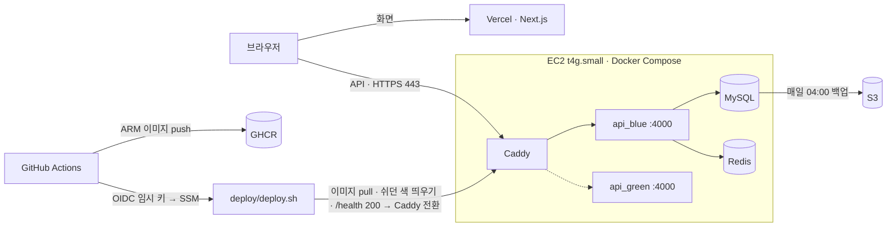

# backend-visualized — 버튼 하나 뒤에서

백엔드 개념을 **그림책처럼** 보여주는 사이트입니다. 버튼을 누르면 실제 서버와 DB에서 문제가 일어나고, 고친 뒤 얼마나 나아졌는지 잰 숫자로 확인할 수 있어요.
프론트엔드 개발자가 백엔드와 배포까지 직접 만들어 본 프로젝트입니다.

- 사이트: https://backend-visualized.vercel.app
- 배포 및 회고: https://backend-visualized.vercel.app/deploy — 서버를 어떻게 올렸고, 왜 그렇게 했고, 어디서 막혔는지
- About me: https://backend-visualized.vercel.app/about

## 여섯 장

| 장  | 페이지                                                              | 다루는 것                                            | API 모듈     |
| --- | ------------------------------------------------------------------- | ---------------------------------------------------- | ------------ |
| 1   | [티켓팅](https://backend-visualized.vercel.app/ticketing)           | 선착순 쿠폰 동시성 (비관적·낙관적 락, 원자적 UPDATE) | `coupons`    |
| 2   | [손목밴드](https://backend-visualized.vercel.app/wristband)         | 액세스·리프레시 토큰, 회전과 재사용 감지             | `auth`       |
| 3   | [묶음배송](https://backend-visualized.vercel.app/delivery)          | 이벤트 수집 SDK, 배치 insert, 레이트 리밋, 일별 집계 | `events`     |
| 4   | [포인트 통장](https://backend-visualized.vercel.app/ledger)         | 포인트 원장(내역)과 대사                             | `points`     |
| 5   | [결제 버튼 두 번](https://backend-visualized.vercel.app/double-pay) | 멱등키(Idempotency-Key)로 중복 결제 막기             | `payments`   |
| 6   | [맛집 메뉴판](https://backend-visualized.vercel.app/cache)          | Redis 캐시, 무효화, 캐시 스탬피드                    | `cache-demo` |

장마다 고른 방법 · 포기한 방법 · 배운 것은 [docs/decisions.md](docs/decisions.md)에 실측 숫자와 같이 있어요.

## 기술 스택

| 영역 | 쓴 것                                                                                                                     |
| ---- | ------------------------------------------------------------------------------------------------------------------------- |
| 화면 | Next.js 15 (App Router) on Vercel · TypeScript · CSS Modules                                                              |
| API  | NestJS · Prisma · MySQL 8.4 · Redis 7.4 (ioredis) · `packages/sdk` 이벤트 수집 SDK                                        |
| 서버 | AWS EC2 `t4g.small` (ARM, Ubuntu 24.04) 한 대 · Docker Compose · Caddy (HTTPS, sslip.io)                                  |
| 배포 | GitHub Actions → GHCR(ARM 이미지) → OIDC → SSM → blue-green 무중단 교체                                                   |
| 운영 | 매일 MySQL 백업 (서버 7일 + S3 30일) · 복원 테스트 · pino JSON 로그 + `x-request-id` · Sentry(선택) · 15분 `/health` 감시 |
| 개발 | pnpm workspace + Turborepo · ESLint · Prettier · `node:test`                                                              |

## 구조



- 밖에서 열린 포트는 80/443(Caddy)과 SSH(내 IP·내 키 전용)뿐이에요. API(4000) · MySQL · Redis는 서버 안쪽 네트워크에만 있어요.
- 배포는 서버가 GitHub을 보는 게 아니라, Actions가 SSM으로 `deploy.sh <SHA>`를 보내는 방식이에요. 배포용으로 열어 둔 포트도, GitHub에 저장한 AWS 키도 없어요.
- 새 버전은 쉬고 있던 색(blue/green)에 먼저 띄우고, `/health`가 200일 때만 Caddy가 넘어가요.

## 숫자로 본 결과 (2026-10-21 측정, /deploy와 같은 값)

| 항목                | 값                                                                                                                 |
| ------------------- | ------------------------------------------------------------------------------------------------------------------ |
| push 뒤 배포 끝까지 | 약 1분 10초 (API 코드가 바뀌면 2분 23초)                                                                           |
| 서버 배포 job       | 135초 → 37~51초 (서버 빌드를 GitHub Actions로 옮긴 뒤)                                                             |
| 배포 중 실패한 요청 | 0번 (배포 3번 동안 0.2초마다 862 · 705 · 565번 요청)                                                               |
| 배포 중 최고 메모리 | 869MiB / 1836MiB (두 색이 잠깐 같이 떠 있을 때)                                                                    |
| 부하 테스트 (k6)    | 최대 약 620 req/s · 50 VU까지 p95 0.12초 · 800 VU에서 p95 10초, 실패 0.89% (전부 시간 초과), 서버는 계속 살아 있음 |
| DB 백업             | 매일 04:00, 서버 7일 + S3 30일, 임시 DB 복원으로 11개 테이블 행 수 일치                                            |

부하 테스트는 2026-10-21에 맥 한 대에서 `load/breakpoint.js`(읽기만: `/health` + `/events/stats`)로 12분 동안 10 → 800 VU까지 올린 결과예요 (389,658 요청, 평균 541 req/s, 중앙값 86ms, p95 2.64초, p99 7.22초). API CPU가 100~120%(2코어 중 1코어)에 머물러, Node 이벤트 루프 하나가 병목이었어요. 서버 한 대의 작은 측정이고 "동시 사용자 수" 주장은 아니에요. 자세한 건 `/deploy`의 회고와 `docs/deploy.md` 7-4.

## 로컬에서 돌리기

Node 20 이상, pnpm 9, Docker가 필요해요.

```bash
pnpm install
cp apps/api/.env.example apps/api/.env          # DATABASE_URL: 아래 compose MySQL이면 포트 3307
cp apps/web/.env.example apps/web/.env.local
docker compose up -d                             # MySQL(bv-mysql, 3307) + Redis(bv-redis, 6380)
pnpm --filter @bv/api prisma:generate
pnpm --filter @bv/api prisma:deploy
pnpm dev                                         # web :3000 · api :4000
```

확인 명령: `pnpm format:check` · `pnpm typecheck` · `pnpm lint` · `pnpm test` · `pnpm build`
(DB·Redis 통합 테스트는 연결이 없으면 건너뛰고, CI에서는 실패로 봐요.)

## 폴더

```
apps/web        Next.js 화면: 장마다 폴더 하나 (ticketing, wristband, …), deploy/ about/
apps/api        NestJS API: 폴더 = URL 첫 단어 = 모듈, prisma/ (스키마 + 마이그레이션)
packages/sdk    이벤트 수집 SDK (@bv/sdk)
deploy/         운영 compose 스크립트, deploy.sh(blue-green), Caddyfile, 백업 스크립트
docs/           배포 · 결정 · 인수인계 · 구조 · 실측 문서
load/           k6 부하 테스트 (선택, 1장)
.github/        CI(검사 + 이미지 빌드), Deploy(GHCR → OIDC → SSM)
```

## 문서

- [docs/deploy.md](docs/deploy.md) — 배포 전체 절차: EC2 준비, Caddy, GHCR + OIDC + SSM, blue-green, 백업과 복원
- [docs/decisions.md](docs/decisions.md) — 장마다 고른 방법 · 포기한 방법 · 배운 것
- [docs/handover.md](docs/handover.md) — 인수인계: 어디에 무엇이 있나, 장별 흐름, 새 장 추가, 한계
- [docs/architecture.md](docs/architecture.md) — 폴더 · 이름 규칙, Nest 개념 ↔ 프론트 비유
- [docs/auth-tokens.md](docs/auth-tokens.md) · [docs/chapters-4-6.md](docs/chapters-4-6.md) · [docs/benchmarks/](docs/benchmarks/)

## 만든 사람

임철순 · [GitHub](https://github.com/POcodingWER) · [블로그](https://pocodingwer.github.io) · [이력서](https://pocodingwer.github.io/about/) · [Instagram](https://www.instagram.com/lim_cuck) · cjftns01@gmail.com
